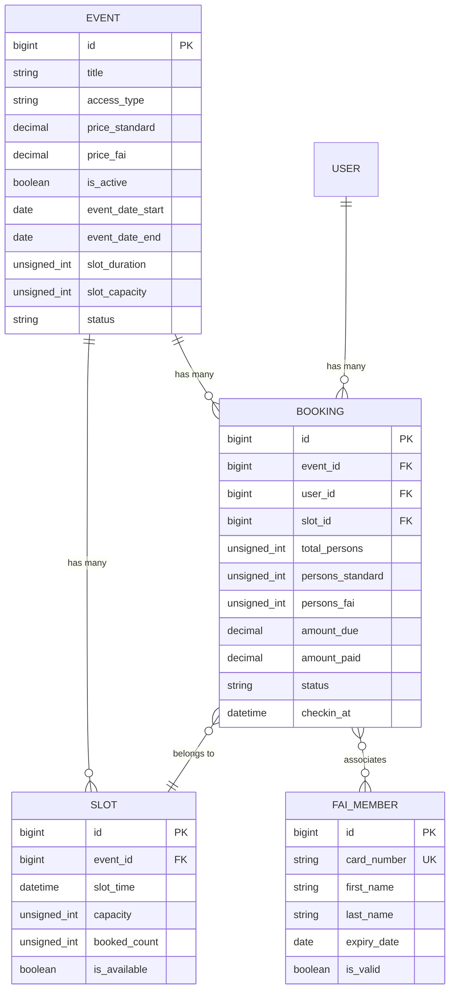

# 🏗️ Architettura e Database

Questo documento descrive i modelli dati principali e le relative relazioni all'interno dell'applicazione DFN Laravel.

---

## 📊 Modelli Dati & Relazioni

---

## 🗃️ Dettaglio Tabelle e Migrazioni

### 1. `events`
Rappresenta un evento o luogo visitabile.
- `title`: Titolo dell'evento.
- `access_type`: Modalità di accesso (es. `slots`, `open`).
- `price_standard` / `price_fai`: Quote di partecipazione differenziate.
- `event_date_start` / `event_date_end`: Date di validità evento.
- `slot_duration`: Durata in minuti di ciascun turno.
- `slot_capacity`: Capienza base per turno.
- `booking_opening_date`: Timestamp di apertura prenotazioni.

### 2. `slots`
Turni orari associati a un evento per gestire ingressi contingentati.
- `event_id`: Riferimento all'evento (FK).
- `slot_time`: Data e orario del turno.
- `capacity`: Posti massimi prenotabili.

### 3. `bookings`
Registrazione delle prenotazioni effettuate da utenti standard o tesserati.
- `event_id`, `user_id`, `slot_id`: Relazioni di appartenenza.
- `total_persons`: Somma di `persons_standard` + `persons_fai`.
- `amount_due` / `amount_paid`: Importi calcolati.
- `checkin_at`: Timestamp per registrazione ingresso in loco.

### 4. `fai_members`
Anagrafica soci per verificare la validità del tesseramento e applicare le tariffe agevolate.
- `card_number`: Numero tessera FAI univoco.
- `expiry_date`: Data di scadenza della tessera.

---

## 📝 Regola di Aggiornamento
Qualsiasi aggiunta di colonne, nuovi modelli Eloquent o alterazione di tabelle richiede l'aggiornamento immediato di questa pagina della Wiki.
