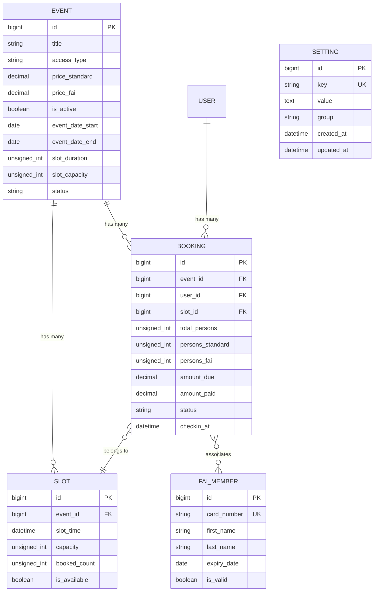

# 🏗️ Architettura e Database

Questo documento descrive i modelli dati principali e le relative relazioni all'interno dell'applicazione DFN Laravel.

---

## 📊 Modelli Dati & Relazioni

---

## 🗃️ Dettaglio Tabelle e Migrazioni

### 1. `events`
Rappresenta un evento o luogo visitabile.
- `title`: Titolo dell'evento.
- `product_id`: Riferimento legacy facoltativo a prodotto WooCommerce pregresso.
- `access_type`: Modalità di accesso (`free_flow` per flusso libero, `time_slots` per fasce orarie).
- `allocation_mode`: Algoritmo di allocazione (`automatic` o `self_selection`).
- `price_standard` / `price_fai`: Quote di partecipazione differenziate (Standard e Soci FAI).
- `event_date_start` / `event_date_end`: Date di inizio e fine evento.
- `event_time_start` / `event_time_end`: Orari apertura e chiusura.
- `slot_duration`: Durata in minuti di ciascun turno (min. 5).
- `slot_capacity`: Capienza base per turno.
- `slot_bonus`: Capienza bonus (staff/live).
- `total_capacity`: Capienza massima complessiva (flusso libero).
- `booking_opening_date`: Timestamp di apertura prenotazioni con countdown.
- `detail_layout`: Layout scheda pubblica (`auto`, `layout1` Galleria, `layout2` Locandina).
- `featured_image`: Locandina/copertina principale dell'evento (path storage).
- `gallery_images`: Foto descrittive per slider pre-evento (JSON array).
- `wall_media`: Foto e video mp4/webm per il wall post-evento (JSON array).
- `show_reviews_frontend`: Toggle per mostrare la valutazione e recensioni nel front-end (boolean).
- `staff_config`: Note operative interne e istruzioni cassa.

### 2. `slots`
Turni orari associati a un evento per gestire ingressi contingentati.
- `event_id`: Riferimento all'evento (FK).
- `slot_time`: Data e orario del turno.
- `capacity`: Posti massimi prenotabili.

### 3. `bookings`
Registrazione delle prenotazioni effettuate da utenti standard o tesserati.
- `event_id`, `user_id`: Relazioni di appartenenza.
- `slot_id`: FK facoltativa verso `slots` per eventi con accesso a turni orari contingentati.
- `booking_code`: Codice univoco pubblico (es. `DFN-2026-XXXX`) utilizzato per consultare il biglietto e scansionare il QR code al check-in.
- `customer_name`, `customer_email`, `customer_phone`: Anagrafica e recapiti dell'intestatario.
- `total_persons`: Somma complessiva di `persons_standard` + `persons_fai`.
- `persons_standard` / `persons_fai`: Conteggio differenziato delle tipologie di partecipante.
- `fai_cards`: Elenco JSON dei numeri di tessera Socio FAI forniti e relativo stato di convalida.
- `amount_due` / `amount_paid`: Importi calcolati in base al listino dell'evento.
- `payment_method`: Metodo prescelto (`in_loco`, online o free).
- `status`: Stato della prenotazione (`confirmed`, `pending_fai`, `pending_payment`, `cancelled`).
- `checkin_status` / `checkin_at` / `checked_in_by`: Timestamp e dati per registrazione ingresso in loco.

### 4. `fai_members`
Anagrafica soci per verificare la validità del tesseramento e applicare le tariffe agevolate.
- `card_number`: Numero tessera FAI univoco.
- `expiry_date`: Data di scadenza della tessera.

### 5. `settings`
Archivio chiave-valore per memorizzare le impostazioni applicative e le policy di caricamento media gestibili da Filament.
- `key`: Chiave univoca dell'impostazione (string, unique, index).
- `value`: Valore memorizzato in formato testo (text, nullable).
- `group`: Gruppo semantico di appartenenza (string, default 'general', index, es. 'media').
- `timestamps`: `created_at` e `updated_at`.

Valori e chiavi per il gruppo `media`:
- `media_max_image_mb`: Dimensione massima in MB per locandina e gallery (range: 1-50, default: 8).
- `media_max_video_mb`: Dimensione massima in MB per video Wall (range: 5-50, default: 50).
- `media_auto_compress`: Toggle compressione e ottimizzazione automatica (boolean, default: true).
- `media_max_dimension_px`: Risoluzione massima in pixel lato lungo (1280, 1920, 2560, default: 1920).
- `media_quality_percent`: Percentuale di qualità compressione (range: 50-95, default: 82).
- `media_convert_webp`: Conversione automatica nel formato WebP (boolean, default: true).

---

## 📝 Regola di Aggiornamento
Qualsiasi aggiunta di colonne, nuovi modelli Eloquent o alterazione di tabelle richiede l'aggiornamento immediato di questa pagina della Wiki.
